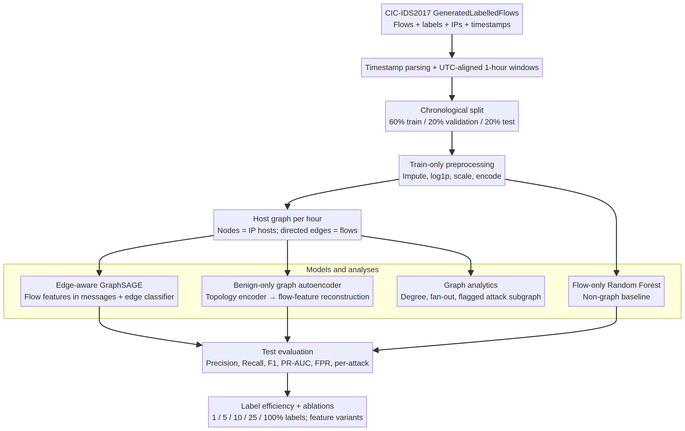
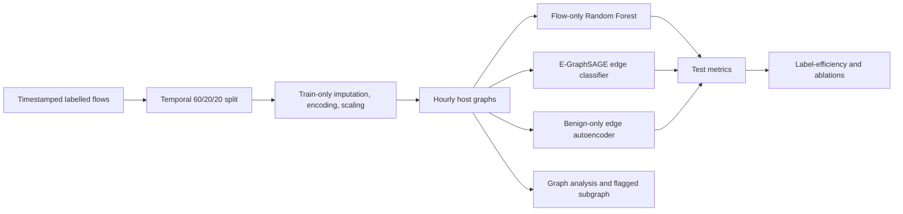

# Graph-based Network Intrusion Detection with GNNs

A small, CPU-runnable portfolio study of network-flow intrusion detection. It compares a flow-only random-forest reference with an edge-classification GraphSAGE model and a benign-only graph autoencoder. The experiments also measure label efficiency, feature/edge ablations, and graph-level traffic structure.

## Dataset and scope

The preferred NF-UNSW-NB15-v2 parquet was downloaded and inspected. The available table has flow features and labels but no source/destination IP addresses or timestamps, so it cannot support host graphs or a defensible chronological split. The common CIC-IDS2017 `MachineLearningCSV` mirror also omits those fields. This project therefore uses the **CIC-IDS2017 GeneratedLabelledFlows** archive, which retains endpoints and timestamps. The official [CIC-IDS2017 page](https://www.unb.ca/cic/datasets/ids-2017.html) describes its labelled flow files and the capture period; the public [Hugging Face mirror](https://huggingface.co/datasets/bencorn/CICIDS2017) provides `GeneratedLabelledFlows.zip`. The loader ignores rows with empty labels rather than treating them as attacks. See [DECISIONS.md](DECISIONS.md) for the dataset selection evidence and trade-offs.

The default run uses a deterministic, class-stratified sample of 40,000 flows. The sample preserves the benign/attack proportion of the archive. Raw data are not included in Git.

## Architecture



Editable source: [docs/architecture.mmd](docs/architecture.mmd).



Nodes are IP hosts. Each flow is a directed edge, carrying its processed flow features. The message-passing graph adds reverse arcs for neighborhood aggregation, while each original flow is classified exactly once. IPs, raw ports, timestamps, and labels are not fed as numeric flow features. Ports are encoded into coarse service/client ranges. See `src/` for the implementation and `LEARNING.md` for interview explanations.

## Quick start

Python 3.12 is the tested runtime. PyTorch is pinned to its CPU wheel.

```bash
python -m pip install -r requirements.txt
python scripts/download_data.py
python -m src.train --config configs/experiment.yaml
python -m unittest discover -s tests -v
```

Override the sample size with `--sample 200000`. Use `--sample 0` to process the full downloaded flow archive; the multi-model/ablation run will take longer. Raw input files under `data/raw/` are ignored by Git; the generated result JSON and figures for this run are committed for review.

## Temporal evaluation and metrics

The CIC timestamp is day/month/year with no timezone offset; it is parsed as UTC by convention. Flows are grouped into whole UTC-aligned one-hour windows and assigned chronologically to train, validation, and test periods (60/20/20). Graph windows do not cross split boundaries. Every imputer, scaler, and encoder is fitted on training flows only. The two graph models run for at most eight epochs with patience-two early stopping on validation loss (benign-only reconstruction loss for the autoencoder); the best validation checkpoint is restored. Validation also chooses the reconstruction-error threshold for the unsupervised model. Final metrics are computed on the test split only.

The main comparison is repeated for seeds 11, 23, and 37. The repository reports precision, recall, F1, macro precision/recall/F1, PR-AUC, false-positive rate, and per-attack precision/recall/F1. The Random Forest and E-GraphSAGE use the conventional 0.5 decision threshold; the autoencoder threshold is selected on validation by F1. The main table shows mean ± population standard deviation rounded to six decimals; full-precision values are in `results/metrics.json`.

## Results

**Completed CPU run:** 40,000 labelled flows, 94 encoded features, 3 seeds (11, 23, 37), 149.4 s for the complete experiment command. The temporal test partition contains 10,250 flows (6,167 benign; 4,083 attacks) from 10 hourly graph windows. Because the split is chronological by whole windows, row counts are not exactly 60/20/20.

| Model | Precision | Recall | F1 | PR-AUC | False-positive rate | Macro F1 (binary) | Attack-macro F1 |
|---|---:|---:|---:|---:|---:|---:|---:|
| Random Forest (flow-only) | 0.997138 ± 0.001068 | 0.284350 ± 0.000000 | 0.442511 ± 0.000105 | 0.916245 ± 0.001657 | 0.000541 ± 0.000202 | 0.625359 ± 0.000101 | 0.257714 ± 0.000107 |
| E-GraphSAGE | 0.996846 ± 0.001182 | 0.258307 ± 0.002802 | 0.410289 ± 0.003575 | 0.870975 ± 0.048154 | 0.000541 ± 0.000202 | 0.606451 ± 0.002106 | 0.242697 ± 0.001715 |
| Benign Graph Autoencoder | 0.670386 ± 0.048764 | 0.535799 ± 0.195781 | 0.580908 ± 0.145290 | 0.641062 ± 0.003601 | 0.163883 ± 0.036656 | 0.681548 ± 0.086110 | 0.271520 ± 0.048779 |

Per-attack F1 (mean ± population standard deviation; test supports in parentheses):

| Model | Bot (25) | DDoS (1,839) | PortScan (2,219) |
|---|---:|---:|---:|
| Random Forest | 0.000000 ± 0.000000 | 0.773141 ± 0.000321 | 0.000000 ± 0.000000 |
| E-GraphSAGE | 0.000000 ± 0.000000 | 0.728090 ± 0.005144 | 0.000000 ± 0.000000 |
| Benign Graph Autoencoder | 0.000000 ± 0.000000 | 0.479731 ± 0.098854 | 0.334828 ± 0.244834 |

Only these three attack labels occur in the chronological test period. At threshold 0.5, the flow-only Random Forest outperforms E-GraphSAGE on this sample (F1 0.443 vs. 0.410; PR-AUC 0.916 vs. 0.871), while both have a low mean false-positive rate and low recall. The graph model therefore shows no advantage over this baseline here. The autoencoder reaches F1 0.581 but has a 16.4% mean false-positive rate. These results do not establish production readiness.

### Label efficiency


The full per-seed results are in `results/label_efficiency.json`.

| Training labels | Test F1 mean ± sample std (3 seeds) |
|---:|---:|
| 1% | 0.314338 ± 0.051098 |
| 5% | 0.393330 ± 0.058687 |
| 10% | 0.483541 ± 0.091472 |
| 25% | 0.359508 ± 0.062783 |
| 100% | 0.410289 ± 0.004378 |

The curve is non-monotonic: 10% labels score higher than 100% in this particular run. This is a diagnostic result, not evidence that fewer labels are generally better. Values are calculated at the fixed 0.5 threshold.

### Ablation

At threshold 0.5, the engineered-feature GNN with edge features reaches F1 0.410289 ± 0.003575, versus 0.265869 ± 0.102210 for the raw-scaled variant. Without edge features, both variants predict no positives at 0.5 (F1 0), despite PR-AUC values around 0.982–0.984; this points to a score-calibration/threshold issue and motivates selecting supervised thresholds on validation in future work. Full results are in `results/ablation.json`.

### Graph analysis and flagged subgraph


Graph statistics are in `results/graph_analysis.json`. A high-fan-out source can be consistent with scanning but is not, by itself, proof of malicious intent.

In this test sample, benign subgraphs average 222.4 hosts per window, while attack-induced subgraphs average only 2.9; the test attacks largely reuse a small number of endpoints. Mean active-source fan-out is 3.00 for benign versus 1.21 for attack-induced subgraphs, so this sample does not exhibit the illustrative pattern of one attack source scanning many hosts. The model-flagged example contains one displayed edge, not a multi-host attack path. This dataset therefore supports flow classification and graph-analysis practice, but is weak evidence for lateral-movement detection.

## Repository map

- `src/data.py`: dataset loading, proportional sampling, timestamp sorting, temporal splits.
- `src/preprocess.py`: train-only imputation/scaling, log transforms, categorical and port encoding.
- `src/build_graph.py`: host-level directed graph windows and edge attributes.
- `src/models/`: flow-only baseline, E-GraphSAGE, and benign-only reconstruction model.
- `src/experiments/run.py`: comparisons, label-efficiency study, ablation, metrics, and figures.
- `notebooks/01_eda.ipynb`: class balance, attack types, top talkers, feature distributions.
- `notebooks/02_graph_analysis.ipynb`: benign/attack topology, subgraph inspection, lateral-movement discussion.
- `tests/`: unit tests for preprocessing and graph construction.

## Limitations

CIC-IDS2017 is a laboratory benchmark captured in 2017, not a current enterprise deployment. These are labelled flow records, not system-call or provenance logs. They do not establish multi-stage lateral movement ground truth. Public flow identifiers are used to build edges but are excluded from model features; remaining benchmark features can still contain dataset-specific artifacts. The default sample is smaller than the full archive, and the results should not be generalized beyond this benchmark. The autoencoder threshold is validation-selected and can shift under deployment drift.

## Next steps

Increase the sample size; test across days or environments; inspect known CIC-IDS2017 artifacts; compare temporal GNNs such as TGN; and adapt the graph schema to host authentication or provenance events for lateral-movement path detection.

## References

- Sharafaldin, I., Lashkari, A. H., and Ghorbani, A. A. (2018). “Toward Generating a New Intrusion Detection Dataset and Intrusion Traffic Characterization.” [ICISSP paper](https://www.scitepress.org/papers/2018/66398/66398.pdf).
- Canadian Institute for Cybersecurity. [CIC-IDS2017 dataset page](https://www.unb.ca/cic/datasets/ids-2017.html).
- Public mirror file: [CICIDS2017 `GeneratedLabelledFlows.zip`](https://huggingface.co/datasets/bencorn/CICIDS2017).
