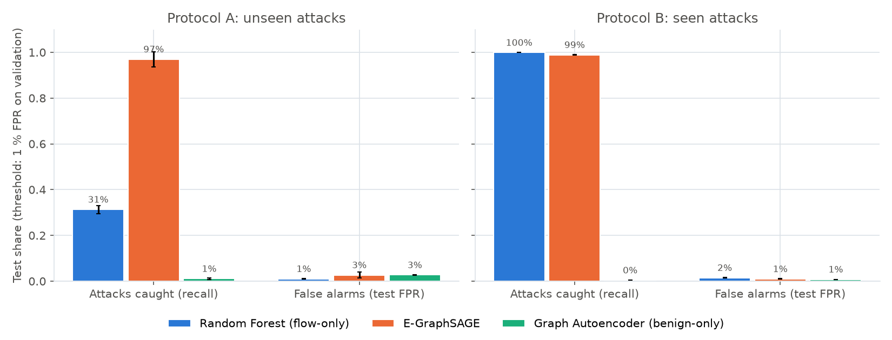
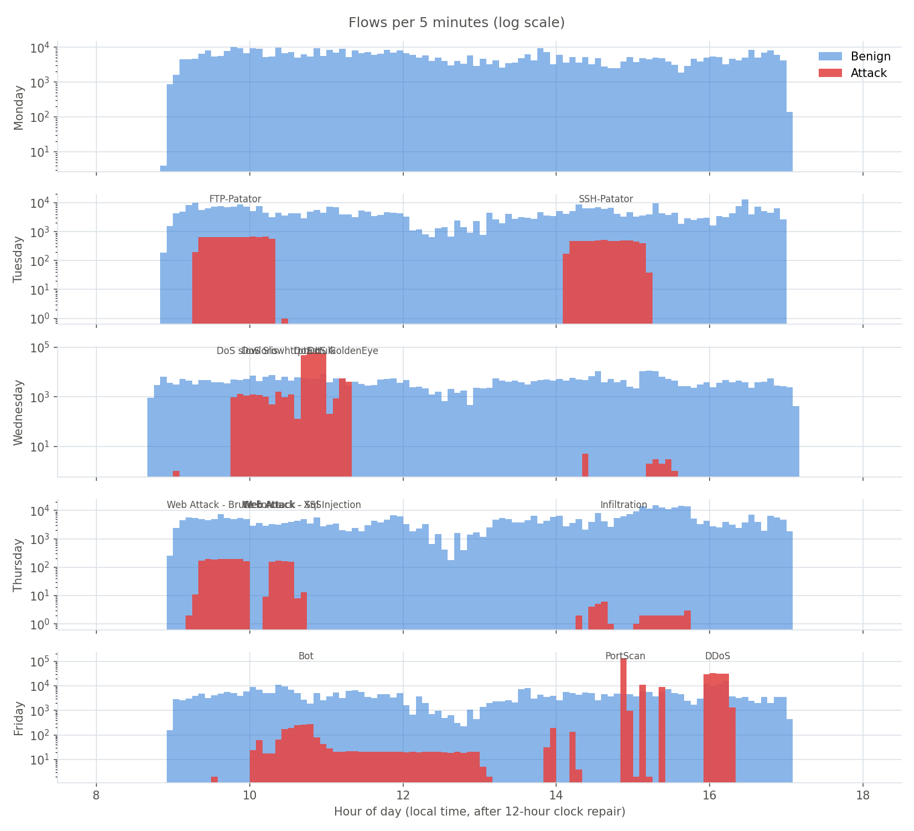
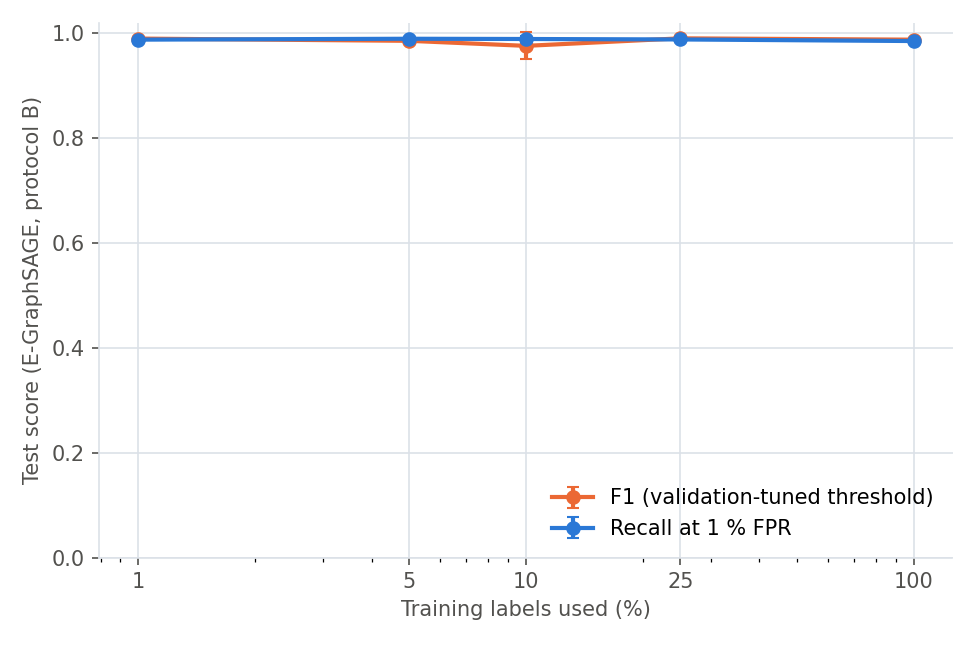
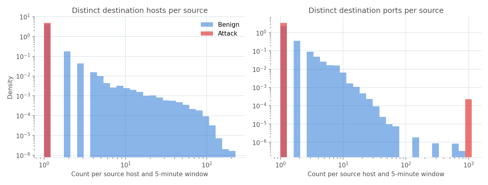
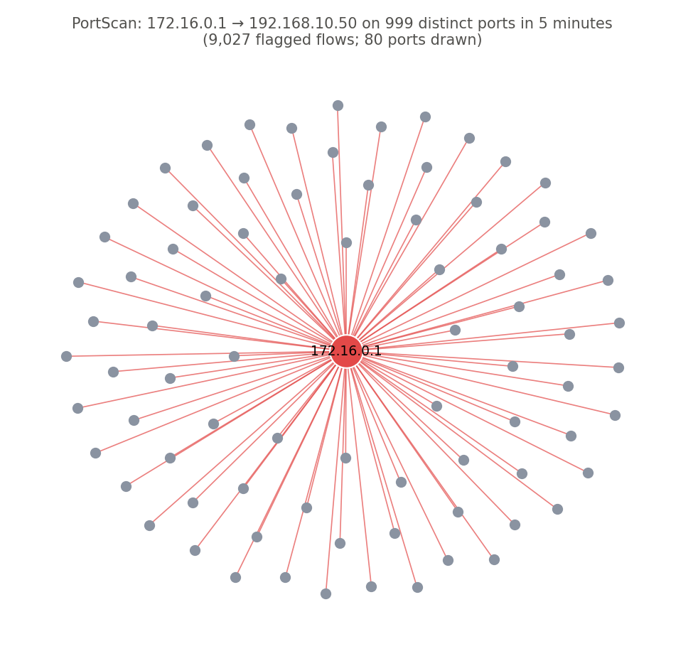

# Graph-based Network Intrusion Detection with GNNs

Detecting attacks in network traffic by modelling it as a graph. Hosts are nodes, flows are edges, and each 5-minute window of traffic becomes one graph. The project compares three detectors on **CIC-IDS2017** (five days of traffic from a lab enterprise network, 2,830,743 labelled flows):

* a **Random Forest** that sees each flow on its own (no graph),
* **E-GraphSAGE**, a supervised graph neural network that classifies each flow (edge) from its own features and its endpoints' neighbourhoods,
* a **graph autoencoder** trained on benign traffic only, which flags flows it cannot reconstruct (no attack labels needed).

It also measures how much labelled data the GNN needs, which inputs matter (ablation), and how attack traffic differs structurally from benign traffic.

## Key results

All numbers below are produced by `python -m src.train` and stored in `results/`. Mean ± standard deviation over seeds 11, 23, 37. Each model's alert threshold is chosen on the validation split, then applied once to the test split.

* **Unseen attacks (protocol A, test = Friday's Bot, PortScan and DDoS):** with the alert threshold set for 1 % false positives on validation, E-GraphSAGE catches **97.0 %** of the attack flows (PortScan 95.8 %, DDoS 100.0 %, Bot 0.6 %; test false-positive rate 2.7 %), against 31.3 % for the flow-only Random Forest (1.0 %) and 1.1 % for the benign-only autoencoder (2.7 %).
* **Seen attacks (protocol B):** F1 is 0.979 for the Random Forest, 0.977 for E-GraphSAGE and 0.564 for the autoencoder (validation-tuned threshold). At 1 % false positives, recall is 99.9 % and 98.9 % respectively.
* **Few labels are enough on seen attacks:** with 1 % of the training labels E-GraphSAGE reaches F1 0.989, against 0.987 with 100 %.
* **Structure carries the signal:** a GNN that sees only graph structure (degrees, distinct peers and ports, no flow statistics) reaches PR-AUC 0.994 on protocol B. In test windows an attacking source contacts on average 54.5 distinct destination ports, against 2.4 for a benign source, but only 1.0 destination host on average: in CIC-IDS2017 external attacks reach the victims through one NAT gateway (172.16.0.1), so attacks show up as many ports between few hosts.
* **Caveat on the autoencoder:** its F1 in protocol A (0.879) is inflated by the test day's attack prevalence (61.8 % of Friday's flows are attacks) and comes with a 17.9 % false-positive rate. Recall at a usable false-positive budget is the fairer comparison.



## Data and evaluation protocols

* **Data:** CIC-IDS2017 `GeneratedLabelledFlows` CSVs (they keep source/destination IPs, ports and timestamps, which graph construction needs). Source: [Canadian Institute for Cybersecurity](https://www.unb.ca/cic/datasets/ids-2017.html), public mirror on [Hugging Face](https://huggingface.co/datasets/bencorn/CICIDS2017).
* **Timestamps:** several CSVs write afternoon times on a 12-hour clock without AM/PM. Hours before 08:00 are shifted by 12 hours; the repaired attack times match the schedule published by the dataset authors (table below, and notebook 01).
* **Topology-preserving reduction:** every attack flow and every window is kept; inside each 5-minute window at most 2,000 benign flows are kept at random. 1,492,235 of 2,830,743 flows are used (all 557,646 attack flows). Unlike random flow sampling, this keeps scans and DDoS stars intact.
* **Protocol A, unseen attacks:** train Monday–Wednesday, validate Thursday, test Friday. Friday's attacks (Bot, PortScan, DDoS) never appear in training, so this measures generalisation to new attack types (a zero-day setting).
* **Protocol B, seen attacks:** each window gets its dominant attack type, and the windows of each type are split chronologically 60/20/20. Every attack type appears in train, validation and test; windows never cross splits. Neighbouring windows of one attack episode can be similar, so protocol B is the optimistic setting.
* **No leakage:** IPs, raw ports, timestamps and labels are never model inputs (IPs only define the graph; ports enter as coarse service/client buckets). Preprocessing is fitted on training flows only.

| Protocol | Split | Flows | Attack flows | Windows | Attack types |
|---|---|---:|---:|---:|---|
| A – unseen attacks | train | 839,766 | 266,507 | 300 | DoS Hulk, DoS GoldenEye, FTP-Patator, SSH-Patator, DoS slowloris, DoS Slowhttptest, Heartbleed |
| A – unseen attacks | val | 184,949 | 2,216 | 98 | Web Attack - Brute Force, Web Attack - XSS, Infiltration, Web Attack - Sql Injection |
| A – unseen attacks | test | 467,520 | 288,923 | 98 | PortScan, DDoS, Bot |
| B – seen attacks | train | 1,005,634 | 433,819 | 298 | DoS Hulk, PortScan, DDoS, DoS GoldenEye, FTP-Patator, DoS slowloris, DoS Slowhttptest, SSH-Patator, Bot, Web Attack - Brute Force, Web Attack - XSS, Infiltration, Web Attack - Sql Injection, Heartbleed |
| B – seen attacks | val | 272,728 | 93,776 | 99 | PortScan, DDoS, DoS Hulk, FTP-Patator, SSH-Patator, DoS slowloris, DoS Slowhttptest, Web Attack - Brute Force, Bot, Web Attack - XSS, Infiltration, Heartbleed |
| B – seen attacks | test | 213,873 | 30,051 | 99 | PortScan, DDoS, SSH-Patator, FTP-Patator, Web Attack - Brute Force, DoS Slowhttptest, Bot, DoS Hulk, Web Attack - XSS, DoS slowloris, Infiltration, Heartbleed |

Attack times after the 12-hour clock repair:

| Day | Attack | First – last flow | Flows |
|---|---|---|---:|
| Friday | Bot | 09:34–12:59 | 1,966 |
| Friday | DDoS | 15:56–16:16 | 128,027 |
| Friday | PortScan | 13:05–15:23 | 158,930 |
| Thursday | Infiltration | 14:19–15:45 | 36 |
| Thursday | Web Attack - Brute Force | 09:15–10:00 | 1,507 |
| Thursday | Web Attack - Sql Injection | 10:40–10:42 | 21 |
| Thursday | Web Attack - XSS | 10:15–10:35 | 652 |
| Tuesday | FTP-Patator | 09:17–10:30 | 7,938 |
| Tuesday | SSH-Patator | 14:09–15:11 | 5,897 |
| Wednesday | DoS GoldenEye | 11:10–11:19 | 10,293 |
| Wednesday | DoS Hulk | 10:43–11:07 | 231,073 |
| Wednesday | DoS Slowhttptest | 10:15–10:37 | 5,499 |
| Wednesday | DoS slowloris | 09:01–14:25 | 5,796 |
| Wednesday | Heartbleed | 15:12–15:32 | 11 |



## Results

### Protocol A – unseen attacks (test = Friday)

| Model | Precision | Recall | F1 | False-positive rate | PR-AUC | Recall at 1 % FPR |
|---|---:|---:|---:|---:|---:|---:|
| Random Forest (flow-only) | 0.979 ± 0.001 | 0.462 ± 0.197 | **0.604 ± 0.171** | 0.0159 ± 0.0060 | 0.981 ± 0.004 | 0.313 ± 0.017 (FPR 0.0104) |
| E-GraphSAGE | 0.994 ± 0.005 | 0.764 ± 0.226 | **0.843 ± 0.161** | 0.0083 ± 0.0082 | 0.995 ± 0.003 | 0.970 ± 0.033 (FPR 0.0269) |
| Graph Autoencoder (benign-only) | 0.888 ± 0.003 | 0.873 ± 0.079 | **0.879 ± 0.040** | 0.1787 ± 0.0143 | 0.848 ± 0.014 | 0.011 ± 0.004 (FPR 0.0272) |

Share of each attack type's test flows flagged, with the threshold set for 1 % validation false positives:

| Attack type (test flows) | Random Forest | E-GraphSAGE | Graph autoencoder |
|---|---:|---:|---:|
| PortScan (158,930) | 5.0 % | 95.8 % | 0.0 % |
| DDoS (128,027) | 64.5 % | 100.0 % | 2.4 % |
| Bot (1,966) | 0.0 % | 0.6 % | 2.2 % |

### Protocol B – seen attacks

| Model | Precision | Recall | F1 | False-positive rate | PR-AUC | Recall at 1 % FPR |
|---|---:|---:|---:|---:|---:|---:|
| Random Forest (flow-only) | 0.970 ± 0.000 | 0.989 ± 0.000 | **0.979 ± 0.000** | 0.0050 ± 0.0001 | 0.987 ± 0.002 | 0.999 ± 0.000 (FPR 0.0151) |
| E-GraphSAGE | 0.991 ± 0.006 | 0.964 ± 0.036 | **0.977 ± 0.016** | 0.0014 ± 0.0010 | 0.994 ± 0.001 | 0.989 ± 0.001 (FPR 0.0098) |
| Graph Autoencoder (benign-only) | 0.398 ± 0.024 | 0.972 ± 0.022 | **0.564 ± 0.022** | 0.2422 ± 0.0297 | 0.465 ± 0.062 | 0.004 ± 0.000 (FPR 0.0081) |

| Attack type (test flows) | Random Forest | E-GraphSAGE | Graph autoencoder |
|---|---:|---:|---:|
| PortScan (20,063) | 100.0 % | 100.0 % | 0.0 % |
| DDoS (7,613) | 100.0 % | 100.0 % | 0.0 % |
| SSH-Patator (998) | 97.8 % | 100.0 % | 0.0 % |
| FTP-Patator (700) | 100.0 % | 98.3 % | 0.0 % |
| Web Attack - Brute Force (201) | 100.0 % | 97.7 % | 0.0 % |
| DoS Slowhttptest (152) | 98.7 % | 0.0 % | 82.2 % |
| Bot (147) | 100.0 % | 96.6 % | 0.0 % |
| DoS Hulk (145) | 100.0 % | 0.0 % | 0.0 % |
| Web Attack - XSS (20) | 85.0 % | 100.0 % | 0.0 % |
| DoS slowloris (5) | 33.3 % | 0.0 % | 0.0 % |
| Infiltration (5) | 93.3 % | 0.0 % | 0.0 % |
| Heartbleed (2) | 100.0 % | 33.3 % | 66.7 % |

### Label efficiency (E-GraphSAGE, protocol B)

| Training labels used | Test F1 | Recall at 1 % FPR |
|---:|---:|---:|
| 1 % | 0.989 ± 0.002 | 0.987 ± 0.003 |
| 5 % | 0.985 ± 0.005 | 0.989 ± 0.001 |
| 10 % | 0.975 ± 0.026 | 0.989 ± 0.005 |
| 25 % | 0.990 ± 0.001 | 0.988 ± 0.002 |
| 100 % | 0.987 ± 0.003 | 0.985 ± 0.002 |



### Ablation (E-GraphSAGE, protocol B)

| Variant | Test F1 | PR-AUC | Recall at 1 % FPR |
|---|---:|---:|---:|
| engineered features | 0.987 ± 0.002 | 0.993 | 0.988 |
| graph structure only | 0.968 ± 0.021 | 0.994 | 0.949 |
| raw scaled features | 0.990 ± 0.002 | 0.995 | 0.991 |

"Graph structure only" sees no flow statistics at all: only degrees, distinct peers and distinct ports per host.

### Benign vs attack graphs, and an extracted attack subgraph

| Source hosts per 5-min window | Distinct destinations (mean / max) | Distinct destination ports (mean / max) | Flows (mean) |
|---|---:|---:|---:|
| Benign | 3.0 / 201 | 2.4 / 784 | 11.7 |
| Attack | 1.0 / 1 | 54.5 / 1000 | 536.6 |



The figure below shows a port scan flagged by E-GraphSAGE in a protocol B test window: `172.16.0.1` probes `192.168.10.50` on 999 distinct ports within 5 minutes (9,027 flagged flows). Every external attack in CIC-IDS2017 enters through one NAT gateway, so the structure is "many ports" rather than "many hosts".



## From flows to provenance graphs and lateral movement

This project works on network flows. Moving to system-log provenance graphs (processes, files, sockets as typed nodes; read/write/fork/connect as typed edges) calls for heterogeneous or temporal GNNs (R-GCN, TGN) instead of the homogeneous GraphSAGE used here. Lateral movement is a path across several hosts and windows, so per-edge detections must be joined: link anomalous edges that share a host and follow each other in time, then score the chain. Evaluating that needs path-level labels (for example LANL or DARPA OpTC) and splits by time and by host. Notebook 02 develops this.

## Limitations

* CIC-IDS2017 is a 2017 lab capture with known labelling artefacts; results do not transfer as-is to a real network.
* Flows, not system logs: no provenance information.
* Benign traffic is thinned inside each window (2,000 flows max), so benign graphs are sparser than in reality; attack traffic is complete.
* Protocol A has a single test day with three attack types; protocol B is optimistic because neighbouring windows of one attack are correlated.
* The autoencoder is a simple design (it reconstructs flow features from structural embeddings); stronger unsupervised graph models exist.

## Reproduce

```bash
pip install -r requirements.txt
python scripts/download_data.py              # CIC-IDS2017 GeneratedLabelledFlows (~270 MB)
python -m src.train --config configs/experiment.yaml
python scripts/create_notebooks.py && jupyter nbconvert --to notebook --execute --inplace notebooks/*.ipynb
python scripts/write_report.py               # regenerates this README from results/
python -m unittest discover -s tests -v
```

Or run everything at once: `python run_all.py` (also used by `RUN_ON_COLAB.ipynb`). The full run took 22 minutes.

## Repository map

* `src/data.py` – loading, timestamp repair, topology-preserving reduction, protocols A and B
* `src/preprocess.py` – train-only imputation, log transform, scaling, categorical and port encoding
* `src/build_graph.py` – one host graph per window, structural node features
* `src/models/` – Random Forest baseline, E-GraphSAGE, benign-only graph autoencoder
* `src/metrics.py` – validation-chosen thresholds, test metrics, per-attack detection rate
* `src/experiments/run.py` – all experiments and figures
* `notebooks/` – data exploration and timestamp check; graph analysis and lateral-movement discussion
* `DECISIONS.md` – design choices; `LEARNING.md` – interview questions and answers

## References

* Sharafaldin, Lashkari, Ghorbani (2018). *Toward Generating a New Intrusion Detection Dataset and Intrusion Traffic Characterization.* ICISSP.
* Lo, Layeghy, Sarhan, Gallagher, Portmann (2022). *E-GraphSAGE: A Graph Neural Network based Intrusion Detection System for IoT.* NOMS.
* Hamilton, Ying, Leskovec (2017). *Inductive Representation Learning on Large Graphs.* NeurIPS.
